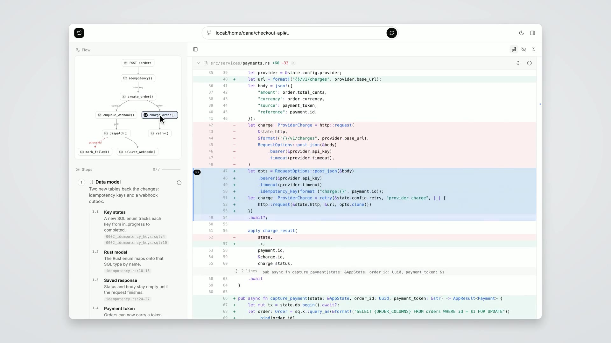

# Diffusion

AI has made it cheaper than ever to write code, but that's only shifted the burden to reviewing it, which is still
largely done the same way it always has been.

Diffusion turns pull requests into guided, interactive walkthroughs that help you understand what changed, how it
works, and why.

## Demo

[](docs/assets/demo.mp4)

A one-minute walkthrough of `/diffusion:review` on a mock 30-file Rust PR: notes, the flow diagram, stepping with
`j`, the file list, ⌘-click go to definition, comments and chat. Click the image to play
[`docs/assets/demo.mp4`](docs/assets/demo.mp4). Music: "Study and Relax" by Kevin MacLeod (public domain, via FreePD).

## From Claude Code

Install the plugin once:

```
/plugin marketplace add Subjective/diffusion
/plugin install diffusion@diffusion
```

Then, in any session:

```
/diffusion:review https://github.com/owner/repo/pull/123   # a PR
/diffusion:review                                          # the current branch against its base
```

## Prerequisites

- **Model access**: an Anthropic, OpenAI, or OpenRouter API key, or a signed-in Claude Code or Codex. Gateways
  and local models work too; see [configuration](docs/configuration.md).
- **git**, and for GitHub PRs `gh` signed in or a `GITHUB_TOKEN`.
- **[`uv`](https://docs.astral.sh/uv/)**.

## Run from source

With Node 24+:

```bash
make install
make build
make serve          # http://127.0.0.1:8787
```

Paste a PR URL into the top bar, or `local:/path/to/repo` to review the current branch against its base
(`local:/path/to/repo#main..my-branch` to choose both).

## CLI

```bash
cd engine
uv run diffusion doctor                # which model it will use; pings it
uv run diffusion open [target]         # start or reuse the web UI and open a review
uv run diffusion guide <target>        # print a guide (--json for the raw guide)
uv run diffusion serve                 # web UI + API
```

## Contributing

See [CONTRIBUTING.md](CONTRIBUTING.md).

## License

[MIT](LICENSE)
